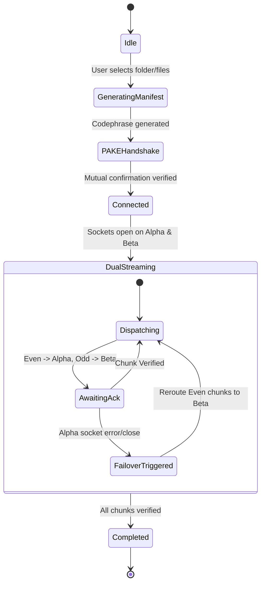

# CrocFlow Codebase Architecture & System Design

> **Philosophy:** "One Single Codebase — Cross-Platform Deployment" without native wrappers or external Go WASM runtime dependencies.

---

## 1. High-Level Architecture Overview

CrocFlow is engineered with a **React 19 + TypeScript + Tailwind CSS** core that compiles simultaneously into three distinct production artifacts:
1. **Progressive Web App (PWA)**: Built using Vite + `vite-plugin-pwa` with full offline service worker caching and client-side IndexedDB persistence.
2. **Mobile Android App (APK)**: Native Android deployment powered by **Capacitor** (`capacitor.config.ts`): a WebView that loads the same static web build (no native camera QR scanner or native file picker). The APK contains no Bridge Server, so it connects to a CrocFlow `server.ts` running on a PC on the same LAN via the configurable Bridge Server address (`src/lib/bridge-origin.ts`).
3. **Desktop App (Windows `.exe`, macOS `.dmg`, Linux `.AppImage`)**: Packaged via **Electron** (`packaging/desktop/`), embedding a lightweight local Node.js bridge server so the desktop executable operates independently out-of-the-box.

```
┌────────────────────────────────────────────────────────────────────────┐
│                   CrocFlow UI (React 19 + TypeScript)                  │
│       [Send]   [Receive]   [Relays]   [History/Groups]   [Docs Hub]    │
│            │                              │                            │
│    (Standard Croc v11)           (Enhanced CrocFlow Mode)              │
│    src/protocol/croc/*           src/protocol/enhanced/*               │
│    PAKE v2 · AES-GCM · XXH64     ECDH · SHA-256 · IndexedDB · 2 Relays │
└────────────┬──────────────────────────────┬────────────────────────────┘
             │ WebSocket /ws                │ WebSocket /ws-dual
             ▼                              ▼
┌────────────────────────────────────────────────────────────────────────┐
│              Unified Node.js Bridge Server (server.ts)                 │
│  • /ws       ➔ Allowlisted TCP bridge (Anti-SSRF) to Croc Relays       │
│  • /ws-dual  ➔ Local Dual-Relay Lab: Relay Alpha (Even) & Beta (Odd)  │
│  • /api/*    ➔ Real RTT measurement & live relay traffic counters      │
└────────────┬───────────────────────────────────────────────────────────┘
             │ Raw TCP Sockets (9009–9017)
             ▼
     Public Croc Relay Cluster (1.getcroc.com ... 4.getcroc.com)
             ↕ (100% Wire Compatible)
     Official Go croc CLI (Windows/macOS/Linux) & getcroc.com
```

---

## 2. Directory Layout & Module Responsibilities

```
crocflow/
├── public/                     # Static assets, SVG icons, Web App Manifest
├── server/                     # Backend Bridge & Local Relay Lab
│   ├── bridge-allowlist.ts     # Anti-SSRF hostname and port sanitization
│   ├── local-dual-relay.ts     # In-memory dual-channel relay (Alpha & Beta)
│   └── server.test.ts          # Backend integration test suite
├── src/
│   ├── components/             # Reusable modular UI views
│   │   ├── AppShell.tsx        # Responsive responsive navigation shell
│   │   ├── SendView.tsx        # Drag-drop sender with QR code generation
│   │   ├── ReceiveView.tsx     # Receiver with Offer preview & Folder Tree
│   │   ├── RelaysView.tsx      # Live RTT latency benchmark table
│   │   ├── HistoryGroupView.tsx# Device alias & rotating monthly passphrases
│   │   ├── AppDocsHubView.tsx  # In-app interactive demo testbed & docs
│   │   └── ProtocolInspector.tsx# Real-time PAKE & chunk matrix visualizer
│   ├── hooks/                  # Custom React hooks (PWA install, etc.)
│   ├── lib/                    # Shared utilities & state stores
│   │   ├── bridge-client.ts    # Frontend client for bridge server communication
│   │   ├── format.ts           # Clean human byte, speed, and time formatters
│   │   ├── group-passphrase.ts # HKDF-SHA-256 monthly rotating secret engine
│   │   ├── history-store.ts    # LocalStorage transfer history & peer presets
│   │   ├── i18n.ts             # Type-safe bilingual engine (VI / EN)
│   │   ├── metrics.ts          # Rolling window throughput & ETA estimation
│   │   ├── relay-manager.ts    # Relay profiling and RTT ranking algorithms
│   │   ├── theme.ts            # Dark/Light theme manager
│   │   └── zip.ts              # Pure client-side ZIP packaging and streaming
│   ├── protocol/               # Cryptographic and network protocol engines
│   │   ├── croc/               # Wire-compatible Croc v11 protocol stack
│   │   │   ├── client.ts       # Croc sender and receiver client state machine
│   │   │   ├── codephrase.ts   # EFF short wordlist codephrase generator
│   │   │   ├── connection.ts   # Binary framing, framing headers, TCP/WS
│   │   │   ├── crypto.ts       # Native WebCrypto AES-GCM and HKDF wrappers
│   │   │   ├── pake.ts         # PAKE v2 P-256 password-authenticated key exchange
│   │   │   └── types.ts        # Croc v11 wire types and binary message formats
│   │   └── enhanced/           # CrocFlow Enhanced Protocol Stack
│   │       ├── dual-relay-scheduler.ts # Even/Odd chunk scheduler with failover
│   │       ├── enhanced-client.ts      # Multi-relay streaming & demo runners
│   │       ├── manifest.ts     # Folder manifest, SHA-256 chunking, path safety
│   │       └── resume-cache.ts # Browser IndexedDB chunk storage
│   └── event-bus.ts            # Real-time event bus feeding Protocol Inspector
├── docs/                       # Comprehensive bilingual technical documentation
│   ├── ARCHITECTURE_EN.md      # This document (English)
│   ├── ARCHITECTURE_VI.md      # Vietnamese version
│   ├── NETWORKING_GUIDE_EN.md  # Networking fundamentals from zero to hero
│   ├── NETWORKING_GUIDE_VI.md  # Vietnamese networking guide
│   ├── DEMO_GUIDE_EN.md        # Technical evaluation and demo guide
│   ├── DEMO_GUIDE_VI.md        # Vietnamese demo guide
│   ├── SETUP_AND_DEPLOY_EN.md  # Zero-to-hero installation and build guide
│   └── SETUP_AND_DEPLOY_VI.md  # Vietnamese setup guide
├── capacitor.config.ts         # Android Capacitor build configuration
├── packaging/desktop/          # Standalone Electron packaging
├── server.ts                   # Express server entry point with Vite middleware
└── vite.config.ts              # Vite bundler, Tailwind CSS v4, PWA configuration
```

---

## 3. Core Subsystems

### 3.1. Standard Croc v11 Protocol Subsystem (`src/protocol/croc/*`)
- **PAKE v2 (Password Authenticated Key Exchange)**:
  - Generates ephemeral NIST P-256 elliptic curve key pairs on both ends.
  - Mixes the public point with the secret codephrase hash to prevent passive eavesdropping and offline dictionary attacks.
  - Derives a 256-bit session key via `HKDF-SHA-256`.
- **Wire Framing**:
  - Croc protocol uses length-prefixed binary frames.
  - Payloads are encrypted using `AES-256-GCM` with a 12-byte random initialization vector (IV) per frame.
  - Integrity is verified via XXH64 / SHA-256 checksums matching the official Go implementation.

### 3.2. Enhanced Protocol Subsystem (`src/protocol/enhanced/*`)
- **Folder Manifest Engine (`manifest.ts`)**:
  - Recursively indexes files into a structured `FolderManifest`.
  - Slices files into deterministic chunks (16 KB, 64 KB, or 256 KB).
  - Calculates per-chunk SHA-256 digests and total file digests.
  - Enforces strict path sanitization via `sanitizeRelativePath` to prevent directory traversal attacks (`../`).
- **Concurrent Dual-Relay Scheduler (`dual-relay-scheduler.ts`)**:
  - Partitions chunk dispatching:
    - Even-indexed chunks (`0, 2, 4, ...`) ➔ `Relay Alpha`
    - Odd-indexed chunks (`1, 3, 5, ...`) ➔ `Relay Beta`
  - Monitors socket health in real-time. If Relay Alpha disconnects, `triggerAlphaFailover()` seamlessly migrates all unacknowledged even chunks to Relay Beta.
- **IndexedDB Resume Cache (`resume-cache.ts`)**:
  - Stores verified chunks in browser storage (`crocflow-resume-db`) keyed by manifest ID, file path, and chunk index.
  - If a connection drops, `computeResumePlan()` compares the manifest against local cache and downloads only missing chunks upon reconnection.

### 3.3. Secure Bridge Server (`server/*`)
- **The Browser Sandbox Constraint**: Browsers cannot open raw TCP sockets to port `9009`.
- **The Bridge Solution**:
  - The browser opens a WebSocket connection to `server.ts` (`/ws?relay=0&port=9009`).
  - `server/bridge-allowlist.ts` validates that the target relay is within the configured allowlist and blocks internal private IP addresses (SSRF defense).
  - Once validated, the bridge pipes raw binary frames between the WebSocket and the remote TCP socket.

---

## 4. State Machines & Concurrency Model

### 4.1. Dual-Relay Sender State Machine



---

## 5. Security & Threat Modeling

| Threat Vector | Mitigation Strategy | Tested In |
| :--- | :--- | :--- |
| **Relay Eavesdropping** | End-to-end encryption with AES-256-GCM. Relays only handle ciphertext and random IVs. | `src/protocol/enhanced/enhanced-transfer.test.ts` |
| **Man-in-the-Middle (MITM)** | PAKE exchange + HKDF bidirectional confirmation tags (`confirmA`, `confirmB`). | `src/protocol/croc/codephrase.test.ts` |
| **Server-Side Request Forgery (SSRF)** | Bridge rejects private RFC 1918 IPs, loopbacks, and cloud metadata IPs (`169.254.169.254`). | `server/bridge-allowlist.test.ts` |
| **Directory Traversal Attack** | Strict POSIX normalization rejecting `..`, root slashes, Windows drives, and control chars. | `src/protocol/enhanced/manifest.test.ts` |
| **Replay Attacks** | Ephemeral P-256 keys, unique session salts, and non-repeating 12-byte GCM IVs per frame. | `src/protocol/croc/types.ts` |
