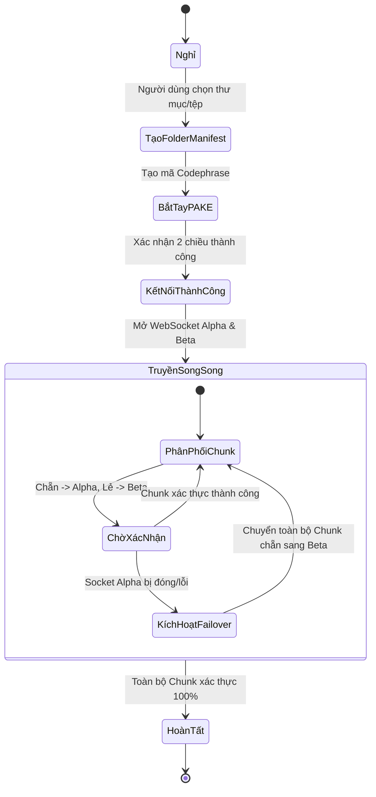

# Kiến Trúc Mã Nguồn & Thiết Kế Hệ Thống CrocFlow

> **Triết lý cốt lõi:** "Duy nhất một mã nguồn — Triển khai đa nền tảng" không phụ thuộc wrapper cồng kềnh hoặc Go WASM runtime.

---

## 1. Tổng Quan Kiến Trúc Đa Nền Tảng

CrocFlow được xây dựng trên nền tảng **React 19 + TypeScript + Tailwind CSS** hiện đại, biên dịch đồng thời ra 3 dạng ứng dụng phục vụ người dùng cuối:
1. **Ứng dụng Web PWA (Progressive Web App)**: Đóng gói bởi Vite + `vite-plugin-pwa`, hỗ trợ Service Worker cache tài nguyên ngoại tuyến và lưu trữ dữ liệu cục bộ bằng IndexedDB.
2. **Ứng dụng Di động Android (APK)**: Đóng gói thông qua **Capacitor** (`capacitor.config.ts`): một WebView tải cùng bản build web tĩnh (chưa có quét mã QR bằng camera hay bộ chọn tệp gốc). APK không chứa Bridge Server nên kết nối tới `server.ts` của CrocFlow chạy trên máy tính cùng mạng LAN thông qua địa chỉ Bridge Server cấu hình được (`src/lib/bridge-origin.ts`).
3. **Ứng dụng Máy tính Desktop (Windows `.exe`, macOS `.dmg`, Linux `.AppImage`)**: Đóng gói qua **Electron** (`packaging/desktop/`), tích hợp sẵn Bridge Server Node.js cục bộ chạy ngầm, tải về mở lên là dùng được ngay.

```
┌────────────────────────────────────────────────────────────────────────┐
│                   Giao diện CrocFlow (React 19 + TypeScript)           │
│        [Gửi]    [Nhận]    [Relay & Mạng]    [Lịch sử/Nhóm]    [Docs]   │
│            │                              │                            │
│    (Chuẩn Croc v11)              (Nâng cao CrocFlow)                   │
│    src/protocol/croc/*           src/protocol/enhanced/*               │
│    PAKE v2 · AES-GCM · XXH64     ECDH · SHA-256 · IndexedDB · 2 Relay  │
└────────────┬──────────────────────────────┬────────────────────────────┘
             │                              │
             │   [Relay Profile: Public]    │ [Relay Profile: Local Lab]
             ▼                              ▼
       WebSocket /ws                  WebSocket /ws-dual
┌────────────────────────────────────────────────────────────────────────┐
│              Máy chủ Bridge Server Hợp Nhất (server.ts)                │
│  • /ws       ➔ Cầu nối TCP allowlist (chống SSRF) tới Relay Croc       │
│  • /ws-dual  ➔ Phòng Lab 2 Relay: Relay Alpha (Chẵn) & Beta (Lẻ)       │
│  • /api/*    ➔ Đo độ trễ RTT thực tế & bộ đếm lưu lượng trực tiếp      │
└────────────┬───────────────────────────────────────────────────────────┘
             │ Socket TCP Thuần (9009–9017)
             ▼
     Cụm Relay Croc Công Cộng (1.getcroc.com ... 4.getcroc.com)
             ↕ (Tương thích 100% Wire Protocol)
     Công cụ dòng lệnh croc CLI chính thức (Go) & getcroc.com
```

---

## 2. Cấu Trúc Thư Mục & Vai Trò Từng Phân Hệ

```
crocflow/
├── public/                     # Tài nguyên tĩnh, biểu tượng SVG, Web App Manifest
├── server/                     # Backend Bridge & Phòng Lab 2 Relay
│   ├── bridge-allowlist.ts     # Bộ lọc kiểm tra host/port, chống tấn công SSRF
│   ├── local-dual-relay.ts     # Triển khai 2 relay Alpha và Beta trong bộ nhớ
│   └── server.test.ts          # Bộ kiểm thử tích hợp backend
├── src/
│   ├── components/             # Các màn hình và thành phần giao diện
│   │   ├── AppShell.tsx        # Khung điều hướng responsive (Desktop & Di động)
│   │   ├── SendView.tsx        # Màn hình Gửi tệp, thư mục, mã QR Code
│   │   ├── ReceiveView.tsx     # Màn hình Nhận tệp, xem trước Offer, Cây thư mục
│   │   ├── RelaysView.tsx      # Quản lý Relay, bảng xếp hạng độ trễ RTT
│   │   ├── HistoryGroupView.tsx# Tên thiết bị & Passphrase nhóm xoay vòng
│   │   ├── AppDocsHubView.tsx  # Trung tâm học thuật, tài liệu & bộ chạy Demo
│   │   └── ProtocolInspector.tsx# Bảng soi giao thức PAKE & Chunk Matrix thời gian thực
│   ├── hooks/                  # React hooks tiện ích (Cài đặt PWA...)
│   ├── lib/                    # Tiện ích dùng chung & quản lý trạng thái
│   │   ├── bridge-client.ts    # Client kết nối tới Bridge Server
│   │   ├── format.ts           # Định dạng byte, tốc độ truyền và thời gian
│   │   ├── group-passphrase.ts # Thuật toán HKDF-SHA-256 xoay vòng mã theo tháng
│   │   ├── history-store.ts    # Lưu lịch sử truyền & danh bạ máy quen vào LocalStorage
│   │   ├── i18n.ts             # Bộ máy đa ngôn ngữ (Tiếng Việt & English)
│   │   ├── metrics.ts          # Đo tốc độ Rolling-window & ước tính thời gian ETA
│   │   ├── relay-manager.ts    # Thuật toán đo RTT và chọn relay tối ưu
│   │   ├── theme.ts            # Quản lý giao diện Sáng / Tối
│   │   └── zip.ts              # Đóng gói và giải nén tệp .ZIP thuần client
│   ├── protocol/               # Bộ xử lý giao thức mạng & mật mã
│   │   ├── croc/               # Ngăn xếp giao thức Croc v11 nguyên bản
│   │   │   ├── client.ts       # Máy trạng thái truyền/nhận chuẩn Croc
│   │   │   ├── codephrase.ts   # Sinh mã bí mật từ từ điển EFF short wordlist
│   │   │   ├── connection.ts   # Đóng khung nhị phân gói tin qua TCP/WebSocket
│   │   │   ├── crypto.ts       # Wrapper mã hóa WebCrypto AES-GCM và HKDF
│   │   │   ├── pake.ts         # Bắt tay mật mã PAKE v2 trên đường cong P-256
│   │   │   └── types.ts        # Định nghĩa các cấu trúc gói tin của Croc v11
│   │   └── enhanced/           # Ngăn xếp giao thức Nâng cao CrocFlow
│   │       ├── dual-relay-scheduler.ts # Bộ lập lịch chia tải chẵn/lẻ & chuyển lỗi
│   │       ├── enhanced-client.ts      # Engine truyền tải song song & bộ chạy Demo
│   │       ├── manifest.ts     # Folder Manifest, băm SHA-256 chunk & chống leo thư mục
│   │       └── resume-cache.ts # Bộ nhớ đệm Chunk lưu trữ trong IndexedDB
│   └── event-bus.ts            # Kênh sự kiện phát dữ liệu tới Bảng soi giao thức
├── docs/                       # Tài liệu kỹ thuật chi tiết song ngữ
│   ├── adr/                    # Các quyết định kiến trúc (ADR-0001..0004)
│   ├── ARCHITECTURE_EN.md      # Tài liệu kiến trúc tiếng Anh
│   ├── ARCHITECTURE_VI.md      # Tài liệu này (Tiếng Việt)
│   ├── DUAL_RELAY_PRESENTATION_VI.md # Tài liệu chuyên sâu Dual-Relay & Thuyết trình
│   ├── NETWORKING_GUIDE_EN.md  # Cẩm nang mạng máy tính tiếng Anh
│   ├── NETWORKING_GUIDE_VI.md  # Cẩm nang mạng máy tính tiếng Việt
│   ├── DEMO_GUIDE_EN.md        # Hướng dẫn demo & đánh giá tiếng Anh
│   ├── DEMO_GUIDE_VI.md        # Hướng dẫn demo & đánh giá tiếng Việt
│   ├── SETUP_AND_DEPLOY_EN.md  # Hướng dẫn cài đặt & build tiếng Anh
│   └── SETUP_AND_DEPLOY_VI.md  # Hướng dẫn cài đặt & build tiếng Việt
├── capacitor.config.ts         # Cấu hình đóng gói Android APK
├── packaging/desktop/          # Cấu hình đóng gói Desktop Electron
├── server.ts                   # Điểm khởi chạy máy chủ Express & Vite middleware
└── vite.config.ts              # Cấu hình Vite, Tailwind CSS v4, PWA Plugin
```

---

## 3. Chi Tiết Các Phân Hệ Cốt Lõi

### 3.1. Ngăn Xếp Chuẩn Croc v11 (`src/protocol/croc/*`)
- **Bắt tay PAKE v2 (Password Authenticated Key Exchange)**:
  - Sinh cặp khóa tạm thời (ephemeral) trên đường cong NIST P-256 ở cả hai đầu.
  - Pha trộn điểm công khai với mã băm của Codephrase bí mật nhằm chống nghe lén và tấn công duyệt từ điển ngoại tuyến (offline dictionary attacks).
  - Dẫn xuất khóa phiên 256-bit thông qua hàm `HKDF-SHA-256`.
- **Đóng khung gói tin (Wire Framing)**:
  - Sử dụng định dạng gói tin nhị phân có tiền tố chỉ độ dài (Length-prefixed binary framing).
  - Toàn bộ khối dữ liệu mã hóa bằng thuật toán `AES-256-GCM` với vector khởi tạo (IV 12-byte) ngẫu nhiên cho từng gói.
  - Kiểm tra tính toàn vẹn bằng mã băm XXH64 / SHA-256 tương thích 100% với mã nguồn gốc của Go.

### 3.2. Ngăn Xếp Nâng Cao CrocFlow (`src/protocol/enhanced/*`)
- **Công cụ Folder Manifest (`manifest.ts`)**:
  - Quét đệ quy thư mục và tạo đối tượng `FolderManifest`.
  - Cắt tệp thành các Chunk cố định (16 KB, 64 KB hoặc 256 KB).
  - Tính mã băm SHA-256 cho từng Chunk riêng biệt và cho từng tệp.
  - Sử dụng hàm `sanitizeRelativePath` chặn đứng rủi ro tấn công leo thư mục (`../`).
- **Bộ Lập Lịch Truyền Song Song 2 Relay (`dual-relay-scheduler.ts`)**:
  - Phân luồng điều phối `Chunk`:
    - Chunk chẵn (`0, 2, 4, ...`) ➔ `Relay Alpha`
    - Chunk lẻ (`1, 3, 5, ...`) ➔ `Relay Beta`
  - Giám sát tình trạng kết nối và `Failover` đối xứng hai chiều (`triggerAlphaFailover()` và `triggerBetaFailover()` qua `triggerLaneFailover()`): khi một trong hai Relay mất kết nối, toàn bộ các `Chunk` chưa `"delivered"` được chuyển tức thời sang Relay còn sống.
- **Bộ Nhớ Đệm Khôi Phục IndexedDB (`resume-cache.ts`)**:
  - Lưu trữ các Chunk đã xác thực trong cơ sở dữ liệu `crocflow-resume-db` của trình duyệt.
  - Khi có mạng trở lại, hàm `computeResumePlan()` đối chiếu Manifest với IndexedDB và chỉ tải những Chunk còn thiếu.

### 3.3. Cầu Nối An Toàn Bridge Server (`server/*`)
- **Rào cản Sandbox Trình Duyệt**: Trình duyệt không thể mở kết nối TCP thô tới cổng `9009`.
- **Giải pháp Bridge Server**:
  - Trình duyệt kết nối WebSocket tới `server.ts` (`/ws?relay=0&port=9009`).
  - `server/bridge-allowlist.ts` kiểm tra danh sách trắng host/port và loại bỏ các dải IP nội bộ nhằm triệt tiêu hoàn toàn lỗ hổng SSRF.
  - Sau khi kiểm duyệt, server làm ống dẫn hai chiều chuyển tiếp các byte nhị phân giữa WebSocket và socket TCP tới Croc Relay.

### 3.4. Kiến Trúc Dual-Relay Theo Relay Profile (ADR-0004)
Theo [ADR-0004](./adr/0004-enhanced-dual-relay-transport-and-handshake.md), `Enhanced Mode` tách biệt lớp giao thức khỏi lớp truyền tải qua giao diện `RelayChannelConnection` trong [`enhanced-client.ts`](../src/protocol/enhanced/enhanced-client.ts):
- **Định tuyến theo `Relay Profile`**:
  - `Public Croc Relays` (`public`): Ghép cặp xác định `(alphaIndex, (alphaIndex + 1) % N)` qua `/ws` + `CrocSocket` (tự thu gọn về đơn kênh `Relay Alpha` nếu có ít hơn 2 `Relay Node` công cộng).
  - `Local Dual-Relay Lab` (`local-lab` / `local-dual`): Kết nối qua `/ws-dual` tới `LocalDualRelayNode` (`server/local-dual-relay.ts`) với phòng Alpha/Beta cô lập và thông báo `peer_count`.
- **Hội tụ bắt tay & Đàm phán**: Bên Nhận phát `pake-init` idempotent theo `peer_count >= 2` và chu kỳ `PAKE_INIT_RETRY_MS = 350` ms cho tới khi nhận `pake-reply`; hai đầu thống nhất `dualRelayAccepted` ngay trong `resume-plan` trước khi phát `Chunk`.
- **Pipelining & Telemetry trung thực**: Giữ cửa sổ `MAX_IN_FLIGHT_PER_LANE = 4` với `chunkDelayMs = 0` trên trình duyệt, phát `lane-down` + `flush()` socket + `markRemainingDelivered()` khi `complete` đến sớm, và hiển thị RTT đo thật (`RTT: N/A` khi `null`, phân biệt `betaAlive === false` với `undefined`) trong `StreamInspectorDrawer.tsx`.
- Xem phân tích đầy đủ và hướng dẫn trình bày chi tiết tại [DUAL_RELAY_PRESENTATION_VI.md](./DUAL_RELAY_PRESENTATION_VI.md).

---

## 4. Mô Hình Máy Trạng Thái & Đồng Bộ Đa Tuyến



---

## 5. Ma Trận Đe Dọa An Ninh & Giải Pháp Bảo Vệ

| Mối đe dọa an ninh | Giải pháp kỹ thuật bảo vệ | Vị trí kiểm thử tự động |
| :--- | :--- | :--- |
| **Nghe lén trên Relay** | Mã hóa E2E bằng AES-256-GCM. Relay chỉ thấy bản mã và IV ngẫu nhiên. | `src/protocol/enhanced/enhanced-transfer.test.ts` |
| **Tấn công xen giữa (MITM)** | Bắt tay PAKE + thẻ xác nhận hai chiều dẫn xuất từ HKDF (`confirmA`, `confirmB`). | `src/protocol/croc/codephrase.test.ts` |
| **Tấn công SSRF qua Bridge** | Lọc bỏ toàn bộ IP nội bộ RFC 1918, loopback và IP metadata đám mây (`169.254.169.254`). | `server/bridge-allowlist.test.ts` |
| **Tấn công leo thư mục (Path Traversal)** | Chuẩn hóa POSIX, chặn ký tự `..`, dấu `/` đầu dòng, ký tự ổ đĩa và ký tự điều khiển. | `src/protocol/enhanced/manifest.test.ts` |
| **Tấn công phát lại (Replay Attacks)** | Cặp khóa P-256 tạm thời, chuỗi muối ngẫu nhiên (`salt`) và IV 12-byte không lặp lại. | `src/protocol/croc/types.ts` |
