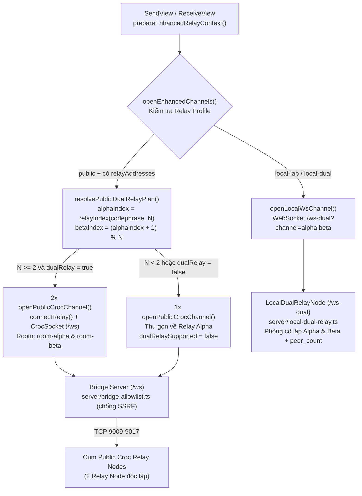
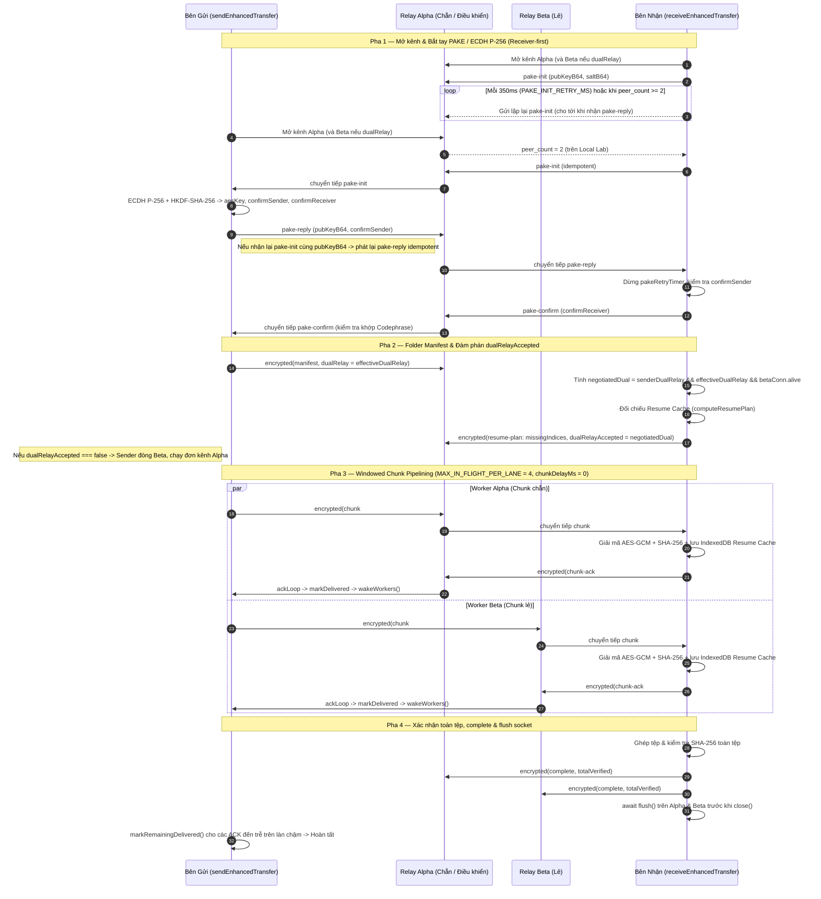
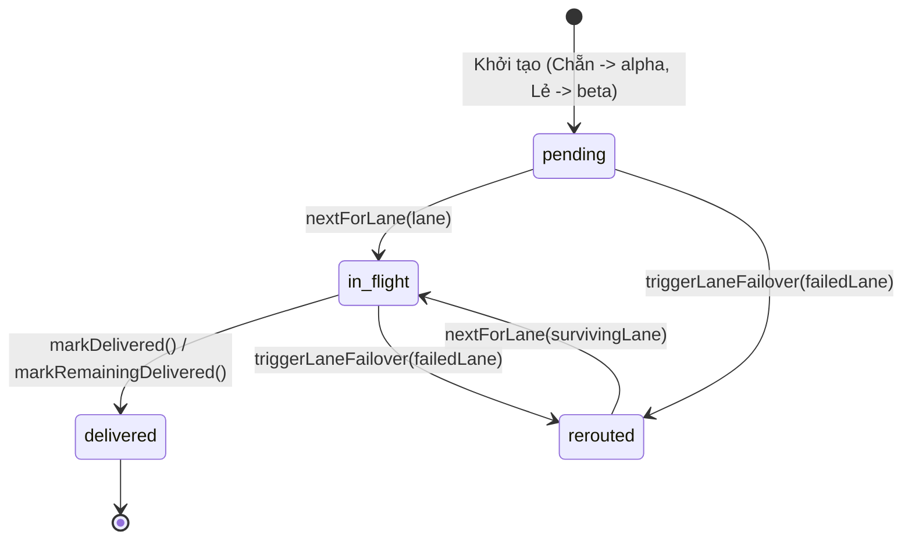

# Kiến Trúc Dual-Relay Transfer Trong CrocFlow: Tài Liệu Chuyên Sâu & Hướng Dẫn Thuyết Trình

> **Tài liệu liên quan:** [Bảng thuật ngữ chuẩn hóa (GLOSSARY.md)](../GLOSSARY.md) · [ADR-0004: Dual-Relay Transport & Handshake](./adr/0004-enhanced-dual-relay-transport-and-handshake.md) · [Kiến trúc hệ thống (ARCHITECTURE_VI.md)](./ARCHITECTURE_VI.md) · [Hướng dẫn trình diễn (DEMO_GUIDE_VI.md)](./DEMO_GUIDE_VI.md)

Tài liệu này hệ thống hóa toàn bộ thiết kế giao thức, mô hình định tuyến, máy trạng thái lập lịch, cơ chế đo kiểm thực tế và lịch sử 5 ca sửa lỗi của **Dual-Relay Transfer** trong **Enhanced Mode**, phục vụ cho việc đọc hiểu mã nguồn và trình bày bảo vệ trước giảng viên hoặc hội đồng đánh giá kỹ thuật.

---

## 1. Tổng Quan Dual-Relay Transfer Trong Enhanced Mode

### 1.1. Lý do ra đời
Trong mô hình truyền tải truyền thống qua một `Relay Node` duy nhất, toàn bộ dữ liệu của một `Transfer Session` phụ thuộc vào một kết nối đơn. Điều này tạo ra hai điểm nghẽn thực tế:
1. **Giới hạn thông lượng đơn tuyến**: Băng thông bị khóa vào một tuyến mạng từ `Bridge Server` tới một `Relay Node`.
2. **Điểm lỗi đơn (Single Point of Failure)**: Khi tuyến Relay đang truyền bị rớt kết nối giữa chừng hoặc nghẽn cục bộ, `Transfer Session` bị gián đoạn ngay lập tức.

`Dual-Relay Transfer` trong `Enhanced Mode` giải quyết bài toán này bằng cách:
- **Ghép kênh song song (Bandwidth Multiplexing)**: Phân phối `Chunk` chẵn (`0, 2, 4, ...`) qua `Relay Alpha` và `Chunk` lẻ (`1, 3, 5, ...`) qua `Relay Beta` chạy đồng thời trên hai tuyến độc lập.
- **Chịu lỗi đối xứng (`Failover`)**: Nếu `Relay Alpha` hoặc `Relay Beta` mất kết nối giữa phiên, bộ lập lịch `DualRelayScheduler` lập tức chuyển các `Chunk` chưa hoàn tất sang làn còn sống mà không làm hỏng dữ liệu.
- **Toàn vẹn & Khôi phục bền vững**: Mỗi `Chunk` trong `Folder Manifest` mang chữ ký `SHA-256` riêng và được lưu xuống `Resume Cache` (IndexedDB `crocflow-resume-db`) ngay sau khi xác thực.

### 1.2. Khác biệt giữa Standard Mode (Croc v11) và Enhanced Mode (CrocFlow)

| Tiêu chí | Standard Mode (Chế Độ Chuẩn Croc v11) | Enhanced Mode (Chế Độ Nâng Cao CrocFlow) |
| :--- | :--- | :--- |
| **Phạm vi tương thích** | Tương thích từng byte với `croc` CLI (Go) và `getcroc.com` | Giao thức ứng dụng-tới-ứng dụng giữa các client CrocFlow |
| **Thư mục mã nguồn** | [`src/protocol/croc/*`](../src/protocol/croc/client.ts) | [`src/protocol/enhanced/*`](../src/protocol/enhanced/enhanced-client.ts) |
| **Bắt tay & khóa phiên** | PAKE v2 trên P-256 + `HKDF` theo đặc tả Croc v11 | ECDH NIST P-256 + `HKDF-SHA-256` (`deriveSessionKeys`) + xác nhận 2 chiều (`confirmSender`, `confirmReceiver`) |
| **Mã hóa & toàn vẹn** | `AES-256-GCM` + kiểm tra `XXH64` / `SHA-256` | `AES-256-GCM` (IV 12 byte ngẫu nhiên mỗi khung) + `SHA-256` cho từng `Chunk` và toàn tệp |
| **Định tuyến Relay** | 1 kênh duy nhất qua `/ws` tới `relayIndex(secret, N)` | 2 làn `Relay Alpha` & `Relay Beta` (hoặc thu gọn về `Alpha`) theo `Relay Profile` đang chọn |
| **Cấu trúc & Resume** | Truyền tuần tự từng tệp theo offer Croc v11 | `Folder Manifest` chống leo thư mục (`sanitizeRelativePath`) + `Resume Cache` IndexedDB |
| **Quan sát trực tiếp** | Ghi mốc PAKE cơ bản vào `Protocol Inspector` | Đầy đủ ma trận `Chunk`, bộ đếm Alpha/Beta/Failover/Resume và RTT từng làn trong `StreamInspectorDrawer` |

---

## 2. Kiến Trúc & Định Tuyến Theo Relay Profile

Toàn bộ `Enhanced Mode` sử dụng chung một giao diện kết nối nội bộ là `RelayChannelConnection` (`src/protocol/enhanced/enhanced-client.ts`), cho phép lớp giao thức phía trên (PAKE, `Folder Manifest`, lập lịch `Chunk`) chạy thống nhất trên hai hạ tầng vận chuyển khác nhau tùy theo `Relay Profile` (`RelayProfileMode` trong `src/lib/relay-manager.ts`):

- `public` (**Public Croc Relays**): Kết nối qua `Bridge Server` (`/ws`) tới cụm `Relay Node` công cộng (`1.getcroc.com` – `4.getcroc.com` hoặc danh sách cấu hình của Bridge).
- `local-lab` / `local-dual` (**Local Dual-Relay Lab**, kiểm tra qua `isLocalLabProfile()`): Kết nối trực tiếp WebSocket tới cặp kênh cô lập trong bộ nhớ (`/ws-dual`) do `LocalDualRelayNode` (`server/local-dual-relay.ts`) quản lý.



### 2.1. Định tuyến `Public Croc Relays` (`/ws` + Croc Framing)
1. **Phân cặp xác định không cần máy chủ điều phối**: Hàm `resolvePublicDualRelayPlan(codephrase, relayAddresses)` (`src/protocol/enhanced/enhanced-client.ts`) tính:
   - `alphaIndex = await relayIndex(codephrase, relayAddresses.length)` (`src/protocol/croc/codephrase.ts` — băm SHA-256 của `Codephrase` chia lấy dư cho `N`).
   - `dualRelaySupported = relayAddresses.length >= 2`.
   - `betaIndex = dualRelaySupported ? (alphaIndex + 1) % relayAddresses.length : alphaIndex`.
   Nhờ phép tính tất định này, cả bên Gửi và bên Nhận chỉ cần cùng một `Codephrase` và cùng danh sách `relayAddresses` là tự động chọn đúng cùng một cặp `Relay Node` khác nhau (`alphaIndex != betaIndex` khi `N >= 2`).
2. **Đóng khung & cô lập phòng**: Mỗi làn gọi `openPublicCrocChannel()` -> `connectRelay()` (`src/protocol/croc/relay.ts`) -> `CrocSocket.connect()` (`src/protocol/croc/transport.ts`) qua endpoint `/ws` của `Bridge Server`. Tên phòng truyền lên Croc Relay được gắn hậu tố làn là `` `${room}-${params.lane}` `` để lưu lượng điều khiển và `Chunk` của `Alpha` và `Beta` không trộn lẫn nếu qua cùng hệ sinh thái Relay.
3. **Tuần tự hóa ghi & xả bộ đệm (`flush`)**: Mọi thông điệp JSON qua `CrocSocket` được mã hóa khung có tiền tố độ dài (`encodeFrame` / `FrameDecoder`) và đẩy nối tiếp qua chuỗi Promise `sendChain`, kèm hàm `flush: () => sendChain` để đảm bảo các byte cuối cùng (như thông điệp `complete`) được gửi hết trước khi đóng kết nối.
4. **Xử lý khi tường lửa chặn cổng TCP `9009–9017`**: Nếu `alphaPromise` không mở được kết nối tới `Public Croc Relay`, `openEnhancedChannels()` ném lỗi rõ ràng hướng dẫn người dùng chuyển `Relay Profile` sang `Local Dual-Relay Lab`.

### 2.2. Định tuyến `Local Dual-Relay Lab` (`/ws-dual`)
- `openLocalWsChannel()` mở WebSocket tới `/ws-dual?channel=<alpha|beta>&room=<room>&role=<sender|receiver>`.
- `LocalDualRelayNode` (`server/local-dual-relay.ts`) xác thực tham số qua `isValidLocalChannel()` (`"alpha" | "beta"`) và `isValidRoomId()` (`/^[a-zA-Z0-9_-]{4,128}$/`).
- Hai bảng phòng `channels.alpha` và `channels.beta` hoàn toàn tách biệt; mỗi bên có bộ đếm `bytesRelayed` và `chunksRelayed` phục vụ `/api/relays/status`.
- Khi peer vào hoặc rời phòng, `notifyPeerCount()` gửi thông điệp `{ type: "peer_count", channel, roomId, count }` cho các socket trong phòng đó; ngoài ra server xử lý khung văn bản `"__ping__"` -> `"__pong__"` để đo RTT trực tiếp.

### 2.3. Thu gọn an toàn khi có ít hơn 2 Relay Node
- Nếu danh sách công cộng chỉ có `1` `Relay Node` (`relayAddresses.length < 2`), `dualRelaySupported` là `false`. Hệ thống tuyệt đối **không** mở 2 kết nối song song vào cùng một `Relay Node` (tránh tranh chấp băng thông giả tạo trên cùng một nút), mà bỏ qua `betaPromise`, đặt `effectiveDualRelay = false` và ghi nhận `betaFallbackReason` lên `Protocol Inspector`.
- Ngoài ra, `openEnhancedChannels()` dùng `Promise.allSettled([alphaPromise, betaPromise])`: nếu `Alpha` thành công nhưng `Beta` thất bại khi mở kênh, `Transfer Session` tự động thu gọn về đơn kênh `Relay Alpha` thay vì làm sập toàn bộ phiên.

### 2.4. Tối ưu chọn Relay nhanh nhất khi sinh Codephrase (`SendView.tsx`)
- Trong `SendView.tsx`, khi người dùng bật `targetFastestRelay` ở `Enhanced Mode` dưới hồ sơ `Public Croc Relays`, hàm `autoGenerateCode()` tìm nút có RTT nhỏ nhất qua `findFastestRelay(latencies, relayAddresses)` (nếu chưa có dữ liệu sẽ gọi `probePublicRelays()`), rồi gọi `generateOptimizedCodephrase(fastest.index, relayAddresses.length)` (`src/protocol/croc/codephrase.ts`, thử tối đa `200` ứng viên) để `Relay Alpha` khớp với `Relay Node` nhanh nhất.
- Để tránh lỗi cạnh tranh bất đồng bộ (race condition), `autoGenerateCode()` tăng bộ đếm đơn điệu `codeGenSeqRef.current` và kiểm tra `isStale()` (`codeGenSeqRef.current !== seq || busyRef.current || userEditedCodeRef.current`) trước khi cập nhật state, đảm bảo các phép đo cũ không ghi đè `Codephrase` người dùng tự gõ hoặc khi vừa chuyển `Relay Profile`.

---

## 3. Vòng Đời Một Transfer Session (Enhanced Mode)



### 3.1. Pha 1: Khởi tạo phòng & Bắt tay ECDH P-256 + HKDF-SHA-256 (Receiver-first)
- **Định danh phòng**: `deriveEnhancedRoom(codephrase)` tạo định danh phòng `cf-${sha256("crocflow-enhanced-room::" + codephrase.trim()).slice(0, 20)}`.
- **Tại sao Receiver chủ động phát `pake-init`?**: Các `Relay Node` công cộng không lưu giữ thông điệp gửi quá sớm trước khi cả hai đầu cùng vào phòng. Vì vậy, `receiveEnhancedTransfer()` thiết kế cơ chế **Receiver-first idempotent**:
  - Bên Nhận sinh cặp khóa ECDH đường cong `P-256` và `salt` ngẫu nhiên 32 byte, đóng gói `pakeInitMsg = { type: "pake-init", pubKeyB64, saltB64 }`.
  - Bên Nhận gửi `pake-init` ngay khi mở kênh, đồng thời lặp lại định kỳ mỗi `PAKE_INIT_RETRY_MS = 350` ms qua `setInterval` và kích hoạt ngay lập tức khi nhận sự kiện `peer_count >= 2` (`handlePeerCount`), cho tới khi nhận được `pake-reply` (`gotPakeReply = true`).
  - Khi bị hủy giữa chừng (`AbortSignal`), `handleAbort()` dọn ngay `pakeRetryTimer`, đóng `alphaConn` / `betaConn` và đóng `AsyncMessageQueue` để không treo Promise.
- **Dẫn xuất khóa & đáp trả idempotent bên Gửi**:
  - `sendEnhancedTransfer()` đợi `pake-init`, sinh cặp khóa ECDH P-256, tính `sharedBits` (256 bit), rồi gọi `deriveSessionKeys()` dùng `HKDF-SHA-256` (với `ikm = ecdhSharedSecret || codephrase`, `salt`, `info = "crocflow-enhanced-v1::" + room`) để xuất `96` byte:
    - `aesKey` (32 byte đầu): khóa đối xứng `AES-256-GCM`.
    - `confirmSender` (32 byte tiếp theo): thẻ chứng minh bên Gửi giữ đúng `Codephrase`.
    - `confirmReceiver` (32 byte cuối): thẻ chứng minh bên Nhận giữ đúng `Codephrase`.
  - Khi chờ `pake-confirm`, nếu bên Gửi nhận thêm bản sao `pake-init` có cùng `pubKeyB64`, bên Gửi phát lại chính thông điệp `pake-reply` đã tạo (idempotent) thay vì sinh khóa mới.

### 3.2. Pha 2: Trao đổi Folder Manifest & Đàm phán `dualRelayAccepted`
- Sau khi xác thực khóa 2 chiều thành công (`bytesEqual` hằng thời gian), toàn bộ dữ liệu tiếp theo được mã hóa `AES-256-GCM` (`encryptPayload` / `decryptPayload` với IV 12 byte ngẫu nhiên).
- Bên Gửi truyền `{ kind: "manifest", manifest, dualRelay: effectiveDualRelay }`.
- Bên Nhận tính toán khả năng chạy song song thực tế:
  ```ts
  const negotiatedDual = senderDualRelay && effectiveDualRelay && Boolean(betaConn?.alive);
  ```
  Nếu `effectiveDualRelay && !negotiatedDual` (ví dụ bên Gửi tắt 2-Relay), bên Nhận đóng ngay `betaConn` nhàn rỗi và chuyển `effectiveDualRelay = false`.
- Sau khi kiểm tra `Resume Cache` qua `computeResumePlan()`, bên Nhận gửi `{ kind: "resume-plan", missingIndices, skippedCount, newFilePaths, dualRelayAccepted: negotiatedDual }`.
- Phía Bên Gửi đọc `decMsg.dualRelayAccepted === false`: nếu trước đó mình mở `Beta`, Bên Gửi đặt `effectiveDualRelay = false`, `betaAlive = false`, đóng `betaConn`, ghi nhận sự kiện lên `Protocol Inspector` và chạy đơn kênh qua `Relay Alpha`.

### 3.3. Pha 3: Windowed Chunk Pipelining (`MAX_IN_FLIGHT_PER_LANE = 4`, `chunkDelayMs = 0`)
- Trước bản sửa lỗi trên `integration/dual-relay-repair`, việc gửi theo kiểu lockstep (gửi 1 `Chunk`, chờ `chunk-ack` mới gửi tiếp) khóa thông lượng ở mức `~1 Chunk / RTT`. Hiện tại `sendEnhancedTransfer()` chạy hai worker song song `runLaneWorker("alpha")` và `runLaneWorker("beta")`:
  - Mỗi làn giữ tối đa `MAX_IN_FLIGHT_PER_LANE = 4` `Chunk` đang bay (`scheduler.inFlightCountForLane(lane) >= 4`).
  - Khi đạt ngưỡng cửa sổ, worker dừng chờ thông qua `waitForWorkerSignal()` (không dùng vòng lặp polling).
  - Ngay khi `ackLoop` xử lý `chunk-ack` (hoặc xảy ra `Failover` / `complete`), hàm `wakeWorkers()` đánh thức các worker ngay lập tức.
  - Trên giao diện gửi thực tế (`SendView.tsx`), `chunkDelayMs` được đặt bằng `0` (và là giá trị mặc định trong `sendEnhancedTransfer`) nhằm loại bỏ hoàn toàn hiện tượng trình duyệt Chromium kẹp `setTimeout` về `1000ms` khi người dùng chuyển sang tab nền. *(Riêng hai kịch bản demo học thuật `runLoopbackDualRelayFailoverDemo` và `runLoopbackFolderResumeDemo` dùng `chunkDelayMs` từ `25–45ms` để người xem kịp quan sát ma trận màu và bấm nút ngắt Alpha).*
- Phía Bên Nhận giải mã từng `Chunk`, kiểm tra `sha256Hex(bytes) === desc.sha256`, lưu ngay vào `Resume Cache` (`cache.save(...)`), rồi gửi `chunk-ack` về đúng `next.lane`. Nếu nhận phải `Chunk` trùng đã lưu trước đó (do `Failover` phát lại), Bên Nhận vẫn gửi lại `chunk-ack` để giải phóng cửa sổ phát cho Bên Gửi.

### 3.4. Pha 4: Hoàn tất, `complete`, `markRemainingDelivered` & `flush()`
- Khi `chunkBuffers.size === manifest.totalChunks`, Bên Nhận ghép lại từng tệp theo `offset` và đối chiếu `sha256Hex(assembled) === fileEntry.fileSha256`.
- Bên Nhận bật `transferComplete = true`, phát `{ kind: "complete", totalVerified: manifest.totalChunks }` lên **tất cả các kênh đang sống** (`alphaConn` và `betaConn`) rồi gọi:
  ```ts
  await Promise.all([
    alphaConn?.flush?.() ?? Promise.resolve(),
    betaConn?.flush?.() ?? Promise.resolve(),
  ]);
  ```
  Bước `flush()` đặc biệt quan trọng với `openPublicCrocChannel()`, bảo đảm `sendChain` đẩy hết khung `complete` xuống WebSocket `/ws` trước khi khối `finally` gọi `close()`.
- Ở Bên Gửi, vì `complete` có thể đến qua làn nhanh trước một vài `chunk-ack` cuối còn kẹt trên làn chậm, nhánh `payload.kind === "complete"` trong `ackLoop` gọi `scheduler.markRemainingDelivered()` để chốt toàn bộ `Chunk` còn lại là `"delivered"`, cập nhật đủ `bytesTransferred` và đánh thức `finishedPromise`.

---

## 4. Cơ Chế Failover Đối Xứng (`DualRelayScheduler`) & Resume Cache IndexedDB

### 4.1. Máy trạng thái `DualRelayScheduler`
[`src/protocol/enhanced/dual-relay-scheduler.ts`](../src/protocol/enhanced/dual-relay-scheduler.ts) là một máy trạng thái thuần (không phụ thuộc socket), quản lý từng `ScheduledChunk`:



- **Đối xứng Alpha <-> Beta**: Cả `triggerAlphaFailover()` và `triggerBetaFailover()` đều ủy quyền về hàm dùng chung `triggerLaneFailover(failedLane: RelayLane)`:
  - Nếu `failedLane === "alpha"` (và `betaAlive === true`): đánh dấu `alphaAlive = false`; mọi `Chunk` có `status !== "delivered"` và `activeLane === "alpha"` được đổi `activeLane = "beta"`, `status = "rerouted"`, `rerouted = true`, tăng `failoverReroutedCount`.
  - Nếu `failedLane === "beta"` (và `alphaAlive === true`): đối xứng hoàn toàn — đặt `betaAlive = false` và chuyển toàn bộ `Chunk` chưa `"delivered"` của Beta sang `activeLane = "alpha"`.
- **Phát hiện sự cố từ cả hai đầu (`enhanced-client.ts`)**:
  1. **Đóng socket trực tiếp hoặc mô phỏng**: `handleClose(lane)` trên Bên Gửi hoặc `handle.simulateAlphaDisconnect()` từ nút UI gọi thẳng `triggerLaneFailover(...)`.
  2. **Thông điệp `lane-down` từ Bên Nhận**: Khi Bên Nhận bị đóng một kênh trước lúc `transferComplete`, `handleClose(closedLane)` tự động gửi `{ kind: "lane-down", lane: closedLane }` qua kênh còn sống; `ackLoop` của Bên Gửi nhận `lane-down` và kích hoạt `triggerLaneFailover(...)` ngay mà không phải đợi lỗi ghi socket.
  3. **Mất làn trước khi vào vòng truyền `Chunk`**: Ngay sau khi khởi tạo `scheduler = new DualRelayScheduler(...)`, Bên Gửi kiểm tra `!alphaAlive` hoặc `!betaAlive` để kích hoạt `triggerAlphaFailover()` / `triggerBetaFailover()` ngay lập tức.

### 4.2. Bộ nhớ đệm `Resume Cache` (IndexedDB)
[`src/protocol/enhanced/resume-cache.ts`](../src/protocol/enhanced/resume-cache.ts) lưu các `Chunk` đã kiểm tra `SHA-256` vào cơ sở dữ liệu `crocflow-resume-db` (object store `verified-chunks`, index `sessionKey`).
- Khóa định danh nội dung (`makeChunkCacheKey` trong [`src/protocol/enhanced/manifest.ts`](../src/protocol/enhanced/manifest.ts)):
  ```ts
  `${filePath}::${chunkIndexInFile}::${sha256}`
  ```
- Nhờ khóa gắn với đường dẫn tương đối đã làm sạch (`sanitizeRelativePath`, chặn `..`, ký tự điều khiển và đường dẫn tuyệt đối) kết hợp mã băm `sha256`:
  - Nếu phiên bị ngắt giữa chừng và kết nối lại, `computeResumePlan()` bỏ qua toàn bộ `Chunk` đã lưu (`skippedChunks`), chỉ yêu cầu `missingIndices`.
  - Nếu Bên Gửi bổ sung thêm tệp mới vào thư mục trước khi nối lại phiên, `computeResumePlan()` tự động phát hiện qua `newFilePaths` và chỉ truyền thêm các `Chunk` của tệp mới mà không tải lại các tệp đã hoàn chỉnh.

---

## 5. Telemetry & Protocol Inspector

### 5.1. Đo lường RTT trung thực (`resolveStreamPairRtts`)
[`src/lib/relay-manager.ts`](../src/lib/relay-manager.ts) cung cấp chuỗi hàm phân giải độ trễ thực tế:
- `extractRelayHost(address)`: Tách tên miền/IP khỏi chuỗi `host:port`.
- `lookupRelayRtt(latencies, relayAddresses, idx)`: Tra cứu lần lượt theo `addr`, `host`, `String(idx)`, `public-${idx}`; chỉ chấp nhận số hữu hạn `>= 0`, nếu không có trả về `null`.
- `resolveStreamPairRtts({ relayProfile, latencies, relayAddresses, alphaIndex, betaIndex })`:
  - Với `Local Dual-Relay Lab`: đọc `latencies["local-alpha"] ?? latencies["local://relay-alpha"] ?? null` và `latencies["local-beta"] ?? latencies["local://relay-beta"] ?? null`.
  - Với `Public Croc Relays`: tra RTT đã đo thực tế của `alphaIndex` và `betaIndex`.
  - **Không dùng số liệu giả**: Tuyệt đối không chèn chuỗi `"<2ms"` hay độ lệch RTT tổng hợp; nếu người dùng chưa bấm đo Ping, RTT giữ nguyên là `null`.

### 5.2. Hiển thị trạng thái trong `StreamInspectorDrawer` & Nút Failover
`SendView.tsx` và `ReceiveView.tsx` gọi `prepareEnhancedRelayContext()` trước khi truyền để lấy `streamPairRtts` đưa vào [`StreamInspectorDrawer.tsx`](../src/components/StreamInspectorDrawer.tsx):
- **`RTT: N/A` khi `null`**: Hàm `renderRttBadge(rttLabel, rttMs)` hiển thị `${rttMs}ms` nếu `typeof rttMs === "number"`, và hiển thị `${rttLabel}: N/A` (`RTT: N/A`) khi giá trị là `null`.
- **Phân biệt `betaAlive === false` với `betaAlive === undefined`**:
  - Trong `reportProgress()` (`enhanced-client.ts`), trường `betaAlive` chỉ mang giá trị boolean khi `Dual-Relay` thực sự bật (`snap.dualEnabled ? snap.betaAlive : undefined` ở Bên Gửi; `effectiveDualRelay ? Boolean(betaConn?.alive) : undefined` ở Bên Nhận). Khi chạy đơn kênh, `betaAlive` là `undefined`.
  - `StreamInspectorDrawer` kiểm tra chặt `const betaSevered = progress.betaAlive === false;` — do đó thẻ `Relay Beta` chỉ hiện badge `"Đã ngắt kết nối"` (`statusSevered`) khi kênh Beta thực sự bị đứt trong phiên Dual-Relay, không bao giờ báo nhầm khi chạy đơn kênh.
  - Tương tự, nút mô phỏng ngắt `Relay Alpha` trong `SendView.tsx` chỉ hiển thị khi `mode === "enhanced" && dualRelay && (!enhProgress || (enhProgress.alphaAlive && enhProgress.betaAlive === true))`.

### 5.3. Bảng soi giao thức toàn cục (`ProtocolInspector.tsx`)
[`ProtocolInspector.tsx`](../src/components/ProtocolInspector.tsx) lắng nghe [`protocolEventBus`](../src/protocol/event-bus.ts) để hiển thị:
1. **5 mốc bắt tay**: `room` -> `pake` -> `hkdf` -> `confirm` -> `stream`.
2. **Ma trận `Chunk`** (tối đa 512 ô): phân biệt màu `pending` (xám), `alpha` (xanh ngọc), `beta` (xanh dương), `verified` (xanh lá), `resumed` (tím chàm), `failover` (hổ phách).
3. **Đồ thị thông lượng** (30 mẫu gần nhất) và **Nhật ký sự kiện** (tối đa 120 dòng, có nút xuất báo cáo Markdown).

---

## 6. Phân Tích 5 Lỗi Thực Tế Đã Chẩn Đoán & Sửa Trên Nhánh `integration/dual-relay-repair`

| STT | Hiện tượng & Nguyên nhân gốc | Cách xử lý đã triển khai | File / Symbol kiểm chứng |
| :--- | :--- | :--- | :--- |
| **1** | **Định tuyến `Relay Profile` sai trên `Public Croc Relays`**: `Enhanced Mode` trước đây luôn gọi thẳng `/ws-dual` cục bộ bất kể đang chọn hồ sơ `public`, khiến hai máy khác host không thể gặp nhau; thiếu kiểm tra `Bridge Server` và không tối ưu `Codephrase` cho `Enhanced Mode`. | Bổ sung `RelayChannelConnection` phân nhánh theo `Relay Profile`: dùng `/ws` + `CrocSocket` qua `openPublicCrocChannel()` trên cặp `(alphaIdx, (alphaIdx + 1) % N)` từ `resolvePublicDualRelayPlan()`, thu gọn về đơn kênh khi `< 2` relay, kiểm tra Bridge qua `prepareEnhancedRelayContext()`, và bật `generateOptimizedCodephrase` kèm guard `codeGenSeqRef` / `userEditedCodeRef`. | `resolvePublicDualRelayPlan`, `prepareEnhancedRelayContext`, `openPublicCrocChannel`, `openEnhancedChannels` (`enhanced-client.ts`); `SendView.tsx`; `ReceiveView.tsx` |
| **2** | **Deadlock PAKE khi Bên Nhận vào phòng trước & rò rỉ khi hủy**: `Relay Node` công cộng không lưu gói `pake-init` đến trước khi Bên Gửi vào phòng, làm phiên treo vô hạn ở bước PAKE; hủy giữa chừng không dọn sạch timer chờ. | Bên Nhận gửi lặp lại `pake-init` một cách idempotent khi `peer_count >= 2` (`handlePeerCount`) và theo chu kỳ `PAKE_INIT_RETRY_MS = 350` ms tới khi có `pake-reply`; Bên Gửi phát lại `pake-reply` idempotent nếu gặp trùng `pake-init.pubKeyB64`; `handleAbort` dọn `pakeRetryTimer` và đóng queue/socket ngay lập tức. | `PAKE_INIT_RETRY_MS`, `handlePeerCount`, `sendPakeInitFn`, `handleAbort` (`enhanced-client.ts`); `notifyPeerCount` (`server/local-dual-relay.ts`) |
| **3** | **Treo phiên khi Sender & Receiver lệch cài đặt Dual-Relay (ON/OFF)**: Khi một bên bật 2-Relay và bên kia tắt, phía bật giữ chờ lưu lượng hoặc xác nhận trên `Relay Beta` mà bên kia không mở. | Bên Gửi gửi cờ `dualRelay` trong `manifest`; Bên Nhận tính `negotiatedDual`, đóng `betaConn` nếu lệch, rồi trả `dualRelayAccepted` trong `resume-plan`. Bên Gửi đọc `dualRelayAccepted === false` để đóng `betaConn` và hạ về đơn kênh `Relay Alpha` trước khi tạo `DualRelayScheduler`. | `DecryptedPayload` (`manifest`, `resume-plan`), khối đàm phán trong `sendEnhancedTransfer` & `receiveEnhancedTransfer` (`enhanced-client.ts`) |
| **4** | **Lockstep ACK chậm, Failover bất đối xứng & race `complete` vs `chunk-ack`**: Gửi từng `Chunk` chờ ACK kẹt ở ~1 `Chunk`/RTT; thiếu `Failover` chiều Beta -> Alpha; không có `lane-down`; socket đóng trước khi xả byte `complete`; `complete` đến trước các `chunk-ack` cuối trên làn chậm gây treo hoặc thiếu tiến độ. | Cửa sổ trượt `MAX_IN_FLIGHT_PER_LANE = 4` + đánh thức sự kiện `wakeWorkers()`; gộp `triggerLaneFailover` đối xứng cho Alpha & Beta; Bên Nhận phát `lane-down` khi rớt làn, broadcast `complete` lên mọi kênh sống và gọi `flush()` trước `close()`; Bên Gửi gọi `scheduler.markRemainingDelivered()` khi nhận `complete`. | `MAX_IN_FLIGHT_PER_LANE`, `wakeWorkers`, `triggerLaneFailover`, `flush()` (`enhanced-client.ts`); `inFlightCountForLane`, `triggerBetaFailover`, `markRemainingDelivered` (`dual-relay-scheduler.ts`) |
| **5** | **Kẹp timer tab nền (`chunkDelayMs`) & Telemetry RTT giả tạo**: Trình duyệt kẹp `setTimeout` ở `1000ms` khi tab chuyển nền; UI từng hiện `"<2ms"` / RTT tự chế khi chưa đo ping và báo nhầm `Relay Beta` bị ngắt khi chạy đơn kênh (`betaAlive === undefined`). | Đặt `chunkDelayMs: 0` cho phiên truyền trình duyệt trong `SendView.tsx`; `resolveStreamPairRtts()` chỉ trả RTT đo thật hoặc `null` (`RTT: N/A`); `reportProgress()` đặt `betaAlive: undefined` ở đơn kênh; `StreamInspectorDrawer.tsx` kiểm tra chặt `betaAlive === false`; nút ngắt Alpha chỉ bật khi `betaAlive === true`. | `resolveStreamPairRtts`, `lookupRelayRtt` (`relay-manager.ts`); `StreamInspectorDrawer.tsx`; `SendView.tsx`; `ReceiveView.tsx` |

---

## 7. Kịch Bản Demo & Thuyết Trình 5 Phút + Bộ Câu Hỏi Q&A Bảo Vệ Đồ Án

### 7.1. Kịch bản thuyết trình 5 phút (Time-boxed)

| Mốc thời gian | Nội dung trình bày & Thao tác trực tiếp | Điểm nhấn kỹ thuật cần nói |
| :--- | :--- | :--- |
| **0:00 – 0:45** | **Đặt vấn đề & Kiến trúc tổng thể**: Mở màn hình **Gửi** và **Relay & Mạng**. | Giải thích lý do tách `Standard Mode` (tương thích `croc` CLI qua `/ws`) và `Enhanced Mode` (ECDH P-256 + `Folder Manifest` + `Dual-Relay Transfer` hỗ trợ cả `Public Croc Relays` lẫn `Local Dual-Relay Lab`). |
| **0:45 – 1:45** | **Demo 1 — Tương thích `Standard Mode` (`croc` CLI)**: Chọn chế độ **Chuẩn Croc v11**, gửi 1 tệp hoặc văn bản, chạy `croc <codephrase>` trên terminal. | Chứng minh `Bridge Server` (`/ws`) chuyển tiếp luồng nhị phân tới `Relay Node` công cộng đồng thời bảo vệ SSRF bằng `server/bridge-allowlist.ts`. |
| **1:45 – 3:15** | **Demo 2 — `Dual-Relay Transfer` & `Failover` trực tiếp**: Mở 2 tab (hoặc bấm **Chạy Failover** trong tab **Tài liệu** -> **Kịch bản Demo**), mở **Bảng soi giao thức** (`Protocol Inspector`) và **Chi tiết luồng** (`StreamInspectorDrawer`). | Chỉ ra 5 mốc PAKE, các ô màu xanh ngọc (`Alpha` chẵn) và xanh dương (`Beta` lẻ) chạy cửa sổ `MAX_IN_FLIGHT_PER_LANE = 4`, sau đó bấm ngắt `Relay Alpha`: các `Chunk` còn lại chuyển sang màu vàng (`Failover`), chảy tiếp qua `Relay Beta` và khớp `SHA-256` 100%. |
| **3:15 – 4:15** | **Demo 3 — `Resume Cache` IndexedDB & Delta Folder**: Bấm **Chạy Resume** (hoặc gửi thư mục qua 2 tab rồi bấm Hủy giữa chừng và nhận lại), mở mục **Resume Cache** ở tab **Nhận**. | Chứng minh các `Chunk` đã lưu trong `crocflow-resume-db` được đánh dấu màu tím (bỏ qua không tải lại), chỉ tải phần còn thiếu và tệp mới thêm. |
| **4:15 – 5:00** | **Tổng kết kỹ thuật & Kiểm chứng tự động**: Chạy nhanh hoặc trình bày kết quả `npm run lint`, `npm run build`, `npm test`. | Nhấn mạnh 5 bài học thực tế đã sửa theo `ADR-0004` (PAKE Receiver-first `350ms`, đàm phán `dualRelayAccepted`, `chunkDelayMs = 0`, RTT trung thực `null -> RTT: N/A`). |

### 7.2. Bộ câu hỏi Q&A bảo vệ đồ án & Bản đồ mở code trực tiếp

#### Câu 1: Nếu Bên Nhận mở phiên và vào phòng trước Bên Gửi, làm sao `pake-init` không bị mất trên `Public Croc Relays`?
- **Trả lời ngắn gọn**: Theo [ADR-0004](./adr/0004-enhanced-dual-relay-transport-and-handshake.md), nhóm không thêm bộ đệm trạng thái lên `Relay Node` hay `Bridge Server` vì `Public Croc Relays` vốn là máy chủ bên ngoài không giữ thông điệp trước khi ghép cặp. Thay vào đó, Bên Nhận chủ động gửi lại `pake-init` một cách idempotent mỗi `350 ms` (`PAKE_INIT_RETRY_MS`) và ngay khi nhận `peer_count >= 2` cho đến khi thấy `pake-reply`; Bên Gửi phát lại `pake-reply` idempotent nếu nhận trùng `pubKeyB64`.
- **Mở code chỉ trực tiếp**: [`src/protocol/enhanced/enhanced-client.ts`](../src/protocol/enhanced/enhanced-client.ts) (`PAKE_INIT_RETRY_MS`, `handlePeerCount`, `sendPakeInitFn`, vòng chờ `pake-confirm` ở dòng ~1042) và [`server/local-dual-relay.ts`](../server/local-dual-relay.ts) (`notifyPeerCount`).

#### Câu 2: Làm sao hai máy trên `Public Croc Relays` biết chọn cùng hai `Relay Node` cho `Relay Alpha` và `Relay Beta` mà không cần máy chủ báo hiệu (signaling) trung tâm?
- **Trả lời ngắn gọn**: Cả hai phía đều dùng chung `Codephrase` và danh sách `relayAddresses` từ `Bridge Server`. Hàm `resolvePublicDualRelayPlan()` dùng `relayIndex(codephrase, N)` (SHA-256 chia lấy dư) để xác định `alphaIndex`, sau đó lấy `betaIndex = (alphaIndex + 1) % N`. Nếu `N < 2`, `dualRelaySupported = false` và tự động chạy đơn kênh trên `Relay Alpha` chứ không mở 2 luồng vào cùng 1 máy chủ.
- **Mở code chỉ trực tiếp**: [`src/protocol/enhanced/enhanced-client.ts`](../src/protocol/enhanced/enhanced-client.ts) (`resolvePublicDualRelayPlan`, `openEnhancedChannels`) và [`src/protocol/croc/codephrase.ts`](../src/protocol/croc/codephrase.ts) (`relayIndex`, `generateOptimizedCodephrase`).

#### Câu 3: Điều gì xảy ra nếu Bên Gửi bật `Dual-Relay Transfer` nhưng Bên Nhận tắt (hoặc ngược lại)?
- **Trả lời ngắn gọn**: Trước khi gửi `Chunk` đầu tiên, Bên Gửi gửi cờ `dualRelay` trong `manifest`, còn Bên Nhận tính `negotiatedDual = senderDualRelay && effectiveDualRelay && Boolean(betaConn?.alive)` và gửi lại `dualRelayAccepted` trong `resume-plan`. Chỉ khi cả hai bên cùng đồng ý và kênh `Beta` mở thành công thì `DualRelayScheduler` mới chia tải chẵn/lẻ; nếu không, cả hai cùng đóng `betaConn` nhàn rỗi và chạy sạch trên `Relay Alpha`.
- **Mở code chỉ trực tiếp**: [`src/protocol/enhanced/enhanced-client.ts`](../src/protocol/enhanced/enhanced-client.ts) (khối `negotiatedDual` ở `receiveEnhancedTransfer` và khối kiểm tra `decMsg.dualRelayAccepted === false` ở `sendEnhancedTransfer`).

#### Câu 4: Tại sao không chờ ACK từng `Chunk` một, và tại sao đặt `chunkDelayMs = 0` trong `SendView.tsx`?
- **Trả lời ngắn gọn**: Chờ ACK tuần tự khóa tốc độ ở `1 Chunk / RTT`. Nhóm chuyển sang cửa sổ trượt `MAX_IN_FLIGHT_PER_LANE = 4` với `wakeWorkers()` đánh thức theo sự kiện ngay khi `chunk-ack` về. Ngoài ra, Chromium kẹp mọi `setTimeout` ở tab chạy nền xuống tối thiểu `1000ms`; đặt `chunkDelayMs = 0` giúp các phiên truyền nhiều megabyte không bị tụt tốc độ khi người dùng chuyển tab.
- **Mở code chỉ trực tiếp**: [`src/protocol/enhanced/enhanced-client.ts`](../src/protocol/enhanced/enhanced-client.ts) (`MAX_IN_FLIGHT_PER_LANE`, `runLaneWorker`, `wakeWorkers`) và [`src/components/SendView.tsx`](../src/components/SendView.tsx) (lời gọi `sendEnhancedTransfer` với `chunkDelayMs: 0`).

#### Câu 5: Nếu `Relay Beta` (hoặc `Relay Alpha`) rớt giữa chừng, hệ thống đảm bảo không mất `Chunk` đang bay (`in-flight`) bằng cách nào? Và nếu `complete` đến trước các `chunk-ack` cuối thì sao?
- **Trả lời ngắn gọn**: Khi một làn rớt (từ `onClose` cục bộ hoặc thông điệp `lane-down` do Bên Nhận gửi qua làn còn sống), `triggerLaneFailover()` chuyển cả các `Chunk` ở trạng thái `"pending"` lẫn `"in-flight"` của làn hỏng sang `"rerouted"` trên làn còn sống. Nếu Bên Nhận đã nhận trùng một `Chunk` trong lúc chuyển tuyến, Bên Nhận vẫn gửi lại `chunk-ack`. Ở cuối phiên, Bên Nhận kiểm tra `SHA-256` toàn tệp, gửi `complete` trên mọi kênh đang sống và gọi `flush()` trước khi đóng socket; Bên Gửi nhận `complete` thì gọi `scheduler.markRemainingDelivered()` để hợp thức hóa mọi `chunk-ack` đến trễ trên làn chậm.
- **Mở code chỉ trực tiếp**: [`src/protocol/enhanced/dual-relay-scheduler.ts`](../src/protocol/enhanced/dual-relay-scheduler.ts) (`triggerLaneFailover`, `triggerAlphaFailover`, `triggerBetaFailover`, `markRemainingDelivered`) và [`src/protocol/enhanced/enhanced-client.ts`](../src/protocol/enhanced/enhanced-client.ts) (`triggerLaneFailover`, `ackLoop`, `flush()`).

#### Câu 6: Làm thế nào `Bridge Server` cho phép trình duyệt nối tới `Public Croc Relays` mà không trở thành lỗ hổng SSRF?
- **Trả lời ngắn gọn**: Client không bao giờ truyền địa chỉ host/IP tùy ý lên `/ws`, mà chỉ truyền chỉ số `relay` (trong danh sách trắng cấu hình trên server) và `port` nằm trong dải cho phép `9009–9017`. `server/bridge-allowlist.ts` kiểm tra chặt `resolveAllowedTarget()` và loại bỏ toàn bộ IP nội bộ (RFC 1918, loopback, cloud metadata `169.254.169.254`).
- **Mở code chỉ trực tiếp**: [`server/bridge-allowlist.ts`](../server/bridge-allowlist.ts) (`resolveAllowedTarget`) và [`server.ts`](../server.ts) (khối `httpServer.on("upgrade")` xử lý `/ws`).

#### Câu 7: Khi chưa đo Ping RTT hoặc khi chạy đơn kênh, `StreamInspectorDrawer` hiển thị như thế nào để không đánh lừa người dùng?
- **Trả lời ngắn gọn**: `resolveStreamPairRtts()` chỉ đọc kết quả ping đã đo trong `latencies`, trả về `null` nếu chưa đo (UI hiển thị `RTT: N/A`, tuyệt đối không bịa số `<2ms`). Đồng thời `betaAlive` chỉ mang giá trị `boolean` khi `Dual-Relay` bật (`undefined` khi đơn kênh), và `StreamInspectorDrawer` chỉ hiển thị trạng thái `"Đã ngắt kết nối"` khi `progress.betaAlive === false`.
- **Mở code chỉ trực tiếp**: [`src/lib/relay-manager.ts`](../src/lib/relay-manager.ts) (`resolveStreamPairRtts`, `lookupRelayRtt`) và [`src/components/StreamInspectorDrawer.tsx`](../src/components/StreamInspectorDrawer.tsx) (`renderRttBadge`, `betaSevered`).

#### Câu 8: Hệ thống chống tấn công leo thư mục (Path Traversal) khi nhận thư mục nhiều cấp như thế nào?
- **Trả lời ngắn gọn**: Mọi đường dẫn trong `FolderManifest` đều đi qua `sanitizeRelativePath()` trước khi băm, lập lịch, lưu `Resume Cache`, xuất `.ZIP` hoặc ghi qua File System Access API; hàm này từ chối null byte, ký tự điều khiển, đường dẫn tuyệt đối (`/`, `C:`) và mọi phân đoạn `..`.
- **Mở code chỉ trực tiếp**: [`src/protocol/enhanced/manifest.ts`](../src/protocol/enhanced/manifest.ts) (`sanitizeRelativePath`, `buildFolderManifest`, `computeResumePlan`).

---

### 7.3. Bản đồ File & Symbol tra cứu nhanh khi bảo vệ

| Chủ đề giảng viên hỏi | File cần mở | Symbol / Hằng số trọng tâm |
| :--- | :--- | :--- |
| Định tuyến `Public` vs `Local Lab` | [`src/protocol/enhanced/enhanced-client.ts`](../src/protocol/enhanced/enhanced-client.ts) | `resolvePublicDualRelayPlan`, `prepareEnhancedRelayContext`, `openEnhancedChannels`, `openPublicCrocChannel`, `openLocalWsChannel` |
| Bắt tay PAKE & đàm phán `dualRelayAccepted` | [`src/protocol/enhanced/enhanced-client.ts`](../src/protocol/enhanced/enhanced-client.ts) | `PAKE_INIT_RETRY_MS`, `deriveSessionKeys`, `handlePeerCount`, `sendPakeInitFn`, `negotiatedDual` |
| Pipelining & Failover đối xứng | [`src/protocol/enhanced/dual-relay-scheduler.ts`](../src/protocol/enhanced/dual-relay-scheduler.ts) | `DualRelayScheduler`, `inFlightCountForLane`, `triggerLaneFailover`, `triggerAlphaFailover`, `triggerBetaFailover`, `markRemainingDelivered` |
| Worker gửi & `flush()` khi kết thúc | [`src/protocol/enhanced/enhanced-client.ts`](../src/protocol/enhanced/enhanced-client.ts) | `MAX_IN_FLIGHT_PER_LANE`, `runLaneWorker`, `wakeWorkers`, `ackLoop`, `flush()` |
| Phòng lab 2 Relay cục bộ `/ws-dual` | [`server/local-dual-relay.ts`](../server/local-dual-relay.ts) | `LocalDualRelayNode`, `notifyPeerCount`, `isValidLocalChannel`, `isValidRoomId` |
| Cầu nối `/ws` & chống SSRF | [`server.ts`](../server.ts), [`server/bridge-allowlist.ts`](../server/bridge-allowlist.ts) | `createCrocFlowServer`, `resolveAllowedTarget` |
| Tối ưu Codephrase & `chunkDelayMs = 0` | [`src/components/SendView.tsx`](../src/components/SendView.tsx) | `autoGenerateCode`, `codeGenSeqRef`, `userEditedCodeRef`, `handleStartSend` |
| Nhận tệp & hiển thị cây thư mục | [`src/components/ReceiveView.tsx`](../src/components/ReceiveView.tsx) | `handleStartReceive`, `FolderTree`, `sanitizeCodephraseInput` |
| Đo RTT thực tế & `StreamInspectorDrawer` | [`src/lib/relay-manager.ts`](../src/lib/relay-manager.ts), [`src/components/StreamInspectorDrawer.tsx`](../src/components/StreamInspectorDrawer.tsx) | `resolveStreamPairRtts`, `lookupRelayRtt`, `findFastestRelay`, `renderRttBadge`, `betaSevered` |
| `FolderManifest` & `Resume Cache` | [`src/protocol/enhanced/manifest.ts`](../src/protocol/enhanced/manifest.ts), [`src/protocol/enhanced/resume-cache.ts`](../src/protocol/enhanced/resume-cache.ts) | `sanitizeRelativePath`, `buildFolderManifest`, `computeResumePlan`, `saveVerifiedChunk`, `loadVerifiedChunkMap` |
